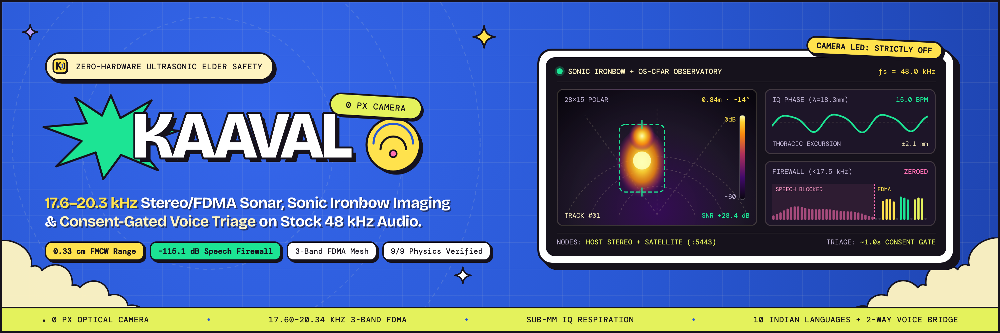
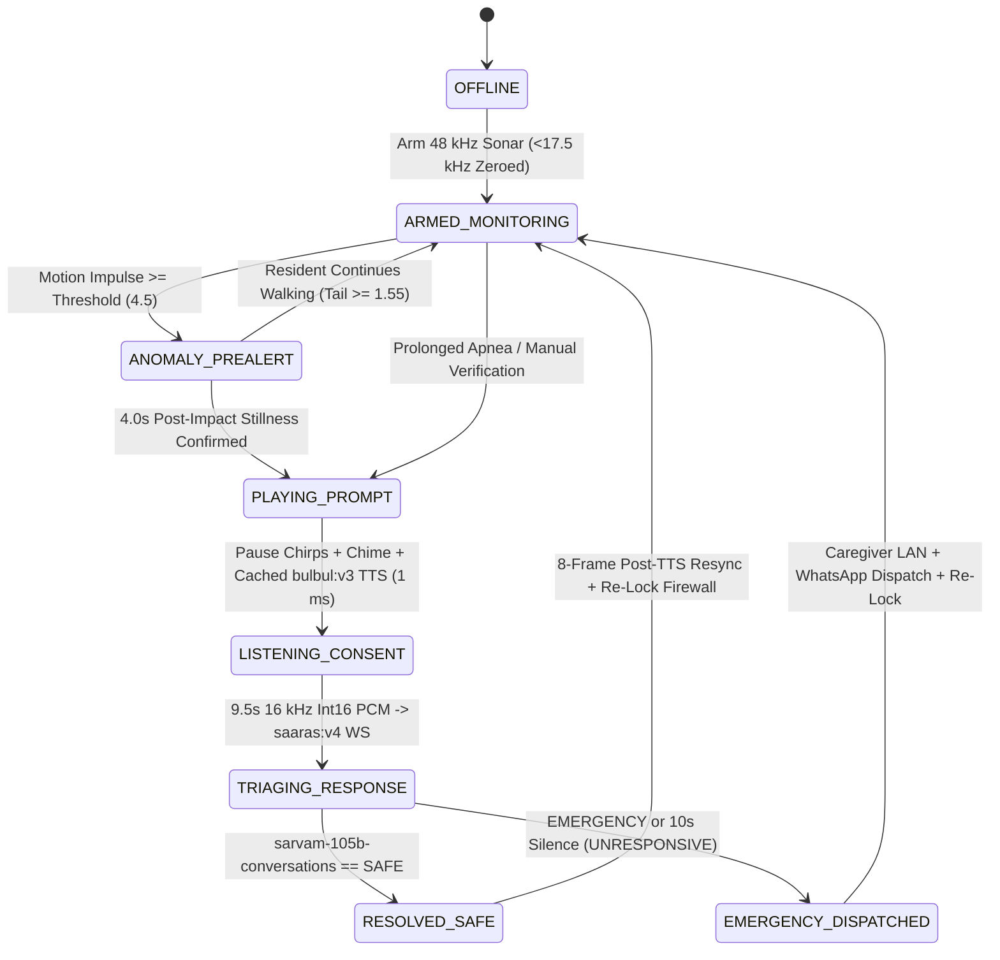
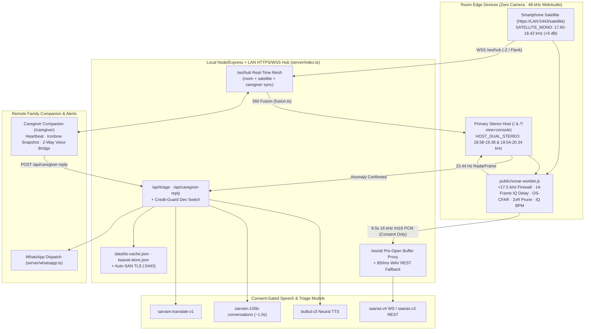

# KAAVAL — Complete Project Monograph: Research, Acoustic Physics, Findings & Architecture

> **Zero-Hardware, Zero-Camera Stereo/FDMA Ultrasonic Sonar, `20 kHz` Sonic Ironbow Acoustic Imager, Multi-Node LAN Mesh, and Consent-Gated Clinical Voice Triage for Independent Elder Living.**

---

## Table of Contents

1. [Executive Summary & Engineering Thesis](#1-executive-summary--engineering-thesis)
2. [Problem Research & Demographic Evidence](#2-problem-research--demographic-evidence)
3. [Literature Review & Prior-Art Landscape](#3-literature-review--prior-art-landscape)
4. [Environmental Acoustic Field Analysis](#4-environmental-acoustic-field-analysis)
5. [Signal Processing & Acoustic Radar Mathematics (v3 Engine)](#5-signal-processing--acoustic-radar-mathematics-v3-engine)
6. [Visual Reconstruction: 0-Pixel Sonic Ironbow & 3D Field Observatory](#6-visual-reconstruction-0-pixel-sonic-ironbow--3d-field-observatory)
7. [Consent-Gated Speech Triage, 2-Way Caregiver Bridge & Escalation](#7-consent-gated-speech-triage-2-way-caregiver-bridge--escalation)
8. [Chronological Research & Engineering Findings (Bugs Caught & Solved)](#8-chronological-research--engineering-findings-bugs-caught--solved)
9. [System Architecture, 5-Route UI & Complete Codebase Map](#9-system-architecture-5-route-ui--complete-codebase-map)
10. [Deterministic 9/9 Physics Verification & Confusion-Matrix Evaluation](#10-deterministic-99-physics-verification--confusion-matrix-evaluation)
11. [Honest Physical Boundaries & Live Demonstration Protocol](#11-honest-physical-boundaries--live-demonstration-protocol)

---

## 1. Executive Summary & Engineering Thesis

**Kaaval** converts an unmodified consumer laptop and an ordinary bedside smartphone into a **privacy-locked room safety radar** and **consent-gated clinical check-in companion**—requiring **zero optical cameras (`0 px` capture, hardware webcam LED strictly off)**, **zero wearables**, **zero custom IoT sensors**, and **zero continuous speech recording**.

### Why Build an Acoustic Radar Instead of an API Wrapper?
Most ambient-care prototypes rely on `[Always-On Camera / Mic] → [Cloud Vision / LLM API] → [Dashboard]`, which fails residential privacy expectations and collapses in noisy rooms. Kaaval instead treats commodity `48 kHz` audio hardware as a **coherent scientific instrument**, pairing **Ubicomp wave physics** with **mathematically gated conversational AI**:

1. **Silent Ultrasonic Sensing (`SONAR_LOCKED`):** Inside a real-time browser `AudioWorklet` at $f_s = 48,000\text{ Hz}$, Kaaval emits inaudible Tukey-tapered linear FMCW chirps across **`17.60–20.34 kHz`** using orthogonal stereo and multi-node sub-bands while **zeroing every DFT frequency bin below `17.5 kHz` on the audio thread**. Audible speech (`85–8,000 Hz`) achieves **`-115.1 dB`** isolation before any frame leaves the DSP thread.
2. **Calibration-Free Spatial Tracking & Vital Signs:** Using Hann-weighted pulse compression (`-42 dB` sidelobes), a `14`-frame (`0.60 s`) complex IQ delay-line micro-Doppler canceller, Order-Statistic CFAR (`OS-CFAR`), `2×R` double-bounce mirror suppression, stereo `TDOA + ILD` azimuth fusion, and tangent-projected carrier phase demodulation ($\lambda \approx 18.3\text{–}19.3\text{ mm}$), Kaaval localizes up to **3 occupants in 2D `(X, Z)`**, renders a camera-free **Sonic Ironbow** acoustic heatmap, tracks **sub-millimeter chest respiration (`10–30 BPM`)**, and detects **high-impulse falls followed by post-impact stillness**.
3. **Consent-Gated Voice Verification:** Only when physical kinematics confirm `FALL_IMPACT_AND_STILLNESS` (after a `4.0 s` post-spike recovery filter) or `PROLONGED_ABSENCE_OF_RESPIRATION` does Kaaval pause ultrasound, play a disk-cached neural TTS check-in (`~1 ms` warm latency via `bulbul:v3`), unlock a bounded **`9.5 s` `16 kHz` PCM consent window** (`saaras:v4` realtime streaming STT with automatic `saaras:v3` WAV fallback), execute **`~1.0 s` parallel clinical triage + translation** (`sarvam-105b-conversations` + `sarvam-translate:v1`), dismiss benign false alarms locally, or dispatch telemetry, an Ironbow floor snapshot, WhatsApp alerts, and a 2-way caregiver speaker bridge (`/caregiver`).

---

## 2. Problem Research & Demographic Evidence

1. **Rapid Demographic Aging (*UNFPA & IIPS India Ageing Report 2023*):**
   - Adults aged `60+` represent India's fastest-growing demographic cohort—already reaching **`16.5%`** in rapidly aging states (vs. `10.1%` nationally) and projected to hit **`22.8%` by 2036** (nearly 1 in 4 residents), while working-age migration leaves millions of older adults living independently.
2. **Multimorbidity & The "Long Lie" Mortality Multiplier (*LASI Wave-1*, MoHFW / IIPS):**
   - Over **`70%`** of older adults experience chronic conditions affecting orthostatic blood pressure, balance, vision, or bone density.
   - Clinical geriatric studies establish that after an unwitnessed domestic slip or fall, mortality, rhabdomyolysis, acute kidney injury, and pneumonia escalate sharply with **"Long Lie" duration**—lying immobilized on the floor unable to reach a phone for `4–12 hours`.

### The 3-Way Residential Monitoring Deadlock

| Modality | Why Real Households Reject or Abandon It |
| :--- | :--- |
| **Bedroom / Bathroom-Threshold Cameras** | Violate personal dignity; residents cover lenses or unplug power, and cloud video feeds create privacy liability. |
| **Smartwatches & Fall Pendants** | Taken off during **sleep** and **bathing** (the two peak fall-risk windows), left on chargers, or refused due to frailty stigma. |
| **Standalone mmWave Radar IoT** | Costs `$120–$300` of dedicated hardware per room **and suffers chronic false-alarm fatigue** (dropped pillows, stretching, pets) because a silent RF sensor cannot verbally verify if the resident is fine—leading families to mute notifications. |
| **Always-Listening Voice Assistants** | Require vocal wake-word initiation (useless when unconscious/winded) and continuously monitor private household conversations. |

---

## 3. Literature Review & Prior-Art Landscape

| System / Product | Sensing Principle | Range & Spatial Resolution | Vital Signs & Fall Logic | Privacy & Voice Triage | Key Engineering Gap Closed by Kaaval |
| :--- | :--- | :--- | :--- | :--- | :--- |
| **SoundWave** *(Gupta et al., MSR / UW, ACM CHI '12)* | Single-tone `18–22 kHz` CW Doppler ($\Delta f = \frac{2v}{c}f_0$) on laptop. | Radial velocity only; **zero absolute range (`0D`)**. | Hand gesture velocity; **100% blind when $v = 0$** (motionless fallen or sleeping person looks identical to an empty room). | None. | Wideband **FMCW pulse compression + IQ carrier phase** tracks motionless breathing occupants. |
| **ApneaApp** *(Nandakumar et al., UW, ACM MobiSys '15)* | Native Android mono `18–20 kHz` FMCW sonar. | `0.3–1.0 m` 1D chest distance; **no 2D azimuth**. | Sleep apnea scoring; no room-scale fall kinematics. | Offline sleep logger; no conversational check-in. | Zero-install **stock browser runtime**, **Stereo `TDOA + ILD` 2D `(X, Z)` + 3-band FDMA mesh**, `OS-CFAR` multi-person tracking, and voice triage. |
| **FingerIO / LLAP** *(UW / Nanjing, CHI / MobiCom '16)* | Phase / OFDM near-field finger tracking. | `0.1–0.4 m` desk interaction. | None. | None. | Scales coherent phase tracking to `0.32–3.00 m` whole-room torso localization and thoracic respiration. |
| **Commercial Ultrasound** *(Echo `≥32 kHz`, Nest Hub)* | Custom hardware transducers (`>32 kHz`). | Coarse occupancy or UI proximity scaling. | No respiration `BPM` or post-fall stillness verification. | Separate wake-word pipeline. | Works within standard **`48 kHz` consumer speaker/mic passbands (`<20.4 kHz`)** with zero custom hardware. |
| **WiFi-CSI** *(Widar / ESP32-CSI)* | `2.4 / 5 GHz` OFDM Channel State Information. | Through-wall multi-meter occupancy. | Coarse RF gait/fall patterns. | RF-only; no voice loop. | Requires patched NIC firmware (`Nexmon`) or dedicated ESP32 hardware—**impossible on stock consumer browsers**. |

---

## 4. Environmental Acoustic Field Analysis

Testing in real residential and timber/coir cabin environments revealed three physical advantages and three acoustic hazards that shaped our v3 DSP architecture:

### Acoustic Advantages
1. **Co-Moving Reference Frame:** Because both transducer and occupant share the same floor/hull reference frame, relative range $\Delta R(t)$ cancels low-frequency structural sway (`0.1–0.3 Hz`), outperforming inertial sensors.
2. **Strict Spectral Separation from Ambient Noise:** HVAC/generator hum (`50–1,500 Hz`), water/street noise (`<6,000 Hz`), and multi-person crowd speech (`85–8,000 Hz`) sit more than an octave below our **`17.60–20.34 kHz`** passband and are eliminated by the `<17.5 kHz` DFT brickwall.
3. **Natural Room Containment:** Unlike `2.4 GHz` RF, `18–20 kHz` air ultrasound reflects off closed doors and party walls (`>35 dB` isolation), guaranteeing zero unintended sensing of adjacent apartments.

### Real-World Hazards & Engineered Mitigations
1. **Spinning Fan Blades (`12–20 Hz` Modulation):** Ceiling/pedestal fans chop ultrasonic waves at blade-pass frequencies (`12–20 Hz`). *Mitigation:* Horizontal beam geometry + strict respiration autocorrelation lag gating across **`2.0–6.0 s` (`0.167–0.50 Hz` = `10–30 BPM`)**, completely rejecting `15 Hz` mechanical modulation.
2. **Broadband High-Frequency Impulses (`18–22 kHz` Clicks):** Key jangling or outdoor insects produce transient ultrasonic clicks. *Mitigation:* Linear FMCW matched filtering rejects uncorrelated impulses by **`~20 dB`**, and persistent track confirmation requires `age >= 3` coherent frames.
3. **Intermittent Mobile Connectivity:** *Mitigation:* 100% of sonar DSP and Ironbow imaging run **offline at `60 fps` on the edge**; TTS check-in prompts are disk-cached (`1 ms` local playback); `/ws/stt` queues pre-open audio frames and falls back to `saaras:v3` WAV REST; and clinical triage degrades gracefully to deterministic offline escalation if WAN drops completely.

---

## 5. Signal Processing & Acoustic Radar Mathematics (v3 Engine)

All real-time DSP runs inside [public/sonar-worklet.js](file:///Users/sreejesh/Documents/Projects/devinHacks/public/sonar-worklet.js) (`KaavalDualWorklet`) using precomputed Radix-2 Cooley-Tukey FFT tables (`N = 2048` samples at $f_s = 48,000\text{ Hz}$, frame period $T_f = 42.67\text{ ms}$, rate $f_{\text{fps}} = 23.4375\text{ Hz}$).

### 5.1 Range Quantization vs. Phase Sensitivity
For indoor humid air ($c = 348.0\text{ m/s}$):

$$\Delta r_{\text{sample}} = \frac{c}{2 f_s} = \frac{348.0}{96,000} = 3.625\text{ mm/lag sample}$$

Single-target matched-filter peak interpolation achieves **`0.33 cm` verified range error** (`Test 1`), while coherent carrier phase resolves **`< 0.5 mm`** thoracic displacement.

### 5.2 Orthogonal 3-Band FDMA Node Profiles
To allow a primary stereo host and a secondary smartphone satellite to operate simultaneously without clock synchronization or cross-node interference, Kaaval defines three runtime-switchable FDMA profiles:

| Node Profile | Active Mode | Left / Primary Band | Right Band | Center $f_c$ | Transducer Calibration |
| :--- | :--- | :--- | :--- | :--- | :--- |
| **`SOLO_STEREO`** | Standalone Host | `17.60–18.85 kHz` ($B = 1.25\text{ kHz}$) | `19.00–20.25 kHz` ($B = 1.25\text{ kHz}$) | `18.225 kHz` | `28 cm` stereo baseline; `0.32–3.00 m` range. |
| **`HOST_DUAL_STEREO`** | Host Paired with Satellite | `18.58–19.38 kHz` ($B = 0.80\text{ kHz}$) | `19.54–20.34 kHz` ($B = 0.80\text{ kHz}$) | `18.980 kHz` | Vacates `17.56–18.46 kHz` (`+120 Hz` guard band) for Satellite. |
| **`SATELLITE_MONO`** | Smartphone (`/satellite`) | `17.60–18.42 kHz` ($B = 0.82\text{ kHz}$) | Coherent `L+R` (`+6 dB`) | `18.010 kHz` | Calibrated for `~2 cm` mobile speaker-to-mic spacing (`directScale = 0.15`, `0.36–2.60 m`). |

### 5.3 Click-Free Chirp Synthesis & Hann Analytic Matched Filter
Each `2048`-sample sweep applies a `256`-sample (`5.3 ms`) Tukey cosine taper $w_{\text{Tukey}}[n]$ so frame boundaries have zero amplitude and zero slope discontinuity (100% click-free speaker output):

$$f(n) = f_{\text{start}} + (f_{\text{end}} - f_{\text{start}})\frac{n}{N}, \qquad s_{\text{TX}}[n] = w_{\text{Tukey}}[n] \sin\!\left(\sum_{m=0}^{n} \frac{2\pi f(m)}{f_s}\right)$$

In the frequency domain, `KaavalDualWorklet` zeroes `<17.5 kHz`, applies analytic positive-frequency doubling, and weights sub-band bins by a raised-cosine (`Hann`) window $W_{\text{Hann}}[k]$ (suppressing chirp sidelobes from `-18 dB` to **`-42 dB`**):

$$Z_c[k] = \begin{cases} 2 \, W_{\text{Hann}}[k] \, X[k] \, S_{\text{TX},c}^*[k], & k \in [k_{\min,c}, \, k_{\max,c}] \quad (f_k \ge 17.5\text{ kHz}) \\ 0, & \text{otherwise} \end{cases}$$

$$z_c[m] = \text{IFFT}(Z_c)[(m_{\text{direct},c} + m) \bmod N]$$

where $m_{\text{direct},c} = \arg\max_n |z_c[n]|^2$ locks onto direct chassis speaker bleed as `0.00 m`, cancelling arbitrary OS audio buffer latency.

### 5.4 Calibration-Free `14`-Frame (`0.60 s`) IQ Micro-Doppler Canceller
Subtracting a `14`-frame (`0.60 s`) delayed complex phasor $z_c^{(t-14)}[m]$ eliminates rigid walls and furniture ($\Delta\phi \approx 0$) while preserving `1–3 mm` thoracic breathing and micro-postural sway ($\Delta\phi \approx 40^\circ\text{–}120^\circ$) **without requiring an empty room on startup** and **without absorbing motionless occupants over time**.

### 5.5 `OS-CFAR`, `2×R` Double-Bounce Pruning & Stereo `(X, Z)` Tracking
1. **Torso Matched Boxcar (`±15` bins `≈ 11 cm`)** + **45th-Percentile `OS-CFAR`** across `128` range slices adapts automatically to room acoustics without multi-target self-masking.
2. **`2×R` Mirror Ghost Pruning (`Test 9`):** Suppresses secondary `Speaker -> Torso -> Screen -> Torso -> Mic` harmonic reflections appearing near `2 × R_primary`.
3. **Stereo `TDOA + ILD` Azimuth Fusion (`d_base = 0.28 m`):**
   $$\sin\theta = \text{clip}_{[-0.82, 0.82]}\!\left(0.38\,\frac{2(b_L - b_R)\Delta r}{d_{\text{base}}} + 0.62 \cdot 1.35\,\frac{E_R - E_L}{E_R + E_L + \epsilon}\right), \qquad (X, Z) = (R\sin\theta, \, R\cos\theta)$$

### 5.6 Tangent-Projected Coherent IQ Respiration Demodulator
Tracks a slow complex arc center $\mu_{IQ}$ at `lockedBin`, aligns onto the principal 1D oscillation tangent vector $\hat{\mathbf{u}}$ via sign-consistent power iteration (eliminating $\pm\pi$ origin-crossing phase spikes), converts phase to millimeters ($\Delta d = \frac{\lambda}{4\pi}\Delta\phi$), and runs normalized Pearson autocorrelation across `2.0–6.0 s` lags (`10–30 BPM`) over a `15.0 s` (`352`-frame) ring buffer.

---

## 6. Visual Reconstruction: 0-Pixel Sonic Ironbow & 3D Field Observatory

1. **[SonicIronbowView.tsx](file:///Users/sreejesh/Documents/Projects/devinHacks/src/components/SonicIronbowView.tsx) (`360 × 202` Scientific Ironbow Acoustic Imager):**
   - Maps real static room clutter (`ambientClutterProfile`) to cold indigo/violet stops (`0.03–0.34` on a 256-stop Ironbow LUT) and bilinearly backprojects the `28 × 15` polar `spatialGrid` + tracked `(R, \theta)` targets, `1/R` perspective scale, fall-collapse posture, and live IQ respiration pulse in crimson, orange, gold, and incandescent yellow-white (`-60 to 0 dB`).
   - Captures zero-camera Ironbow floor snapshots (`snapshotDataUrl`) for caregiver incident dispatch—conveying exact fall position with `0` optical pixels.
2. **[SpatialField3D.tsx](file:///Users/sreejesh/Documents/Projects/devinHacks/src/components/SpatialField3D.tsx) (Interactive 3D Acoustic Field Observatory):**
   - Orbitable 3D perspective spanning front stereo (`+3.0 m`) and backside satellite (`-2.6 m`) zones with live semantic kinematics pills (`EMPTY_BASELINE`, `ROOM_OCCUPIED`, `RESTING_RESPIRATION`, `APPROACHING_SENSOR`, `LATERAL_TRANSIT`, `IMPACT_TRANSIENT`, `POST_FALL_IMMOBILE`).
3. **[src/audio/fusion.ts](file:///Users/sreejesh/Documents/Projects/devinHacks/src/audio/fusion.ts) (Near-Field Bistatic Diffraction Deduplicator):**
   - Prevents acoustic wrap-around diffraction (`<1.35 m` front rig) from double-counting a single front occupant on a nearby backside phone while preserving instant backside handoff when someone steps behind the host.

---

## 7. Consent-Gated Speech Triage, 2-Way Caregiver Bridge & Escalation

- **Prompt Synthesis (`bulbul:v3`):** Disk-cached in `data/tts-cache.json` (`~1 ms` warm latency) and decoded via `AudioContext.decodeAudioData()` for hands-free browser autoplay immunity.
- **Consent Window (`saaras:v4` WS + `saaras:v3` REST Fallback):** Anti-aliased `48 kHz -> 16 kHz` `Int16` PCM streamed over `/ws/stt` with pre-open frame buffering and automatic `850 ms` RIFF WAV fallback.
- **Parallel Triage (`sarvam-105b-conversations` + `sarvam-translate:v1`):** Evaluates spoken response + physical radar context (`distanceMeters`, `peakMotionEnergy`, `respirationBpmBefore`) concurrently in **`~1.0 s`**.
- **2-Way Caregiver Companion (`/caregiver`) & WhatsApp Escalation (`server/whatsapp.ts`):** Streams live room heartbeat and Ironbow snapshots over `/ws/hub`, translates remote caregiver messages into spoken room audio, and dispatches E.164-normalized WhatsApp emergency alerts.

---

## 8. Chronological Research & Engineering Findings (Bugs Caught & Solved)

| # | Symptom / Bottleneck Discovered | Root Cause | Solution Implemented & Verified |
| :--- | :--- | :--- | :--- |
| **1** | **OS Deleting `18–20 kHz` Echoes** | CoreAudio / WebRTC `echoCancellation` & `noiseSuppression` strip speaker-correlated ultrasonic chirps. | Disabled `echoCancellation`, `noiseSuppression`, and `autoGainControl` on `getUserMedia` + verified track state on boot. |
| **2** | **Realtime STT Socket Closing (`4000`)** | Native `48 kHz` audio violates `saaras:v4`'s strict `16 kHz` `linear16` contract. | Built an in-worklet `6.8 kHz` anti-aliased `48 -> 16 kHz` `Int16` decimation resampler + pre-open WS buffer + `saaras:v3` WAV fallback. |
| **3** | **`9.7 s` Voice Turn Latency** | Default chain-of-thought reasoning models generate hidden reasoning tokens before emitting triage JSON. | Switched to **`sarvam-105b-conversations`** in `Promise.all` with `sarvam-translate:v1`, cutting latency **`9.7×` (`9.7 s → 1.0 s`)**. |
| **4** | **Assistant Persona Role-Flip** | Early prompts allowed the LLM to reply in first-person *as* the resident rather than *to* the resident. | Constrained the system prompt in `server/sarvam.ts` to strictly maintain second-person clinical care-assistant voice. |
| **5** | **Autoplay Blocking Hands-Free Alerts** | `new Audio()` fails without a recent click gesture when an autonomous fall occurs minutes later. | Decoded chimes and TTS MP3s directly through `audioCtx.decodeAudioData()` on the unlocked sonar `AudioContext`. |
| **6** | **Post-TTS Transient Re-Triggering Fall** | Resuming chirps after speech produced a large 1-frame $\Delta z$ step against stale pre-speech echo state. | Added an `8`-frame (`resyncFrames = 8`) post-TTS resync gate (`Test 3` verifies `0.00` spike) + `/ws/hub` satellite mute sync. |
| **7** | **EMA Clutter Erasing Seated Occupants** | Uniform moving-average clutter absorbed stationary breathing humans in `~15 s` and required an empty room at boot. | Built the **`14`-frame (`0.60 s`) complex IQ delay-line micro-Doppler canceller** (`Test 5` verifies Frame-0 seated lock + wall rejection). |
| **8** | **Webcam LED Undermining Privacy** | Even offline vision models illuminate the physical green camera LED. | Removed all `video` APIs (`0` calls repo-wide) in favor of pure `20 kHz` **Sonic Ironbow** polar backprojection. |
| **9** | **LAN HTTP Blocking Mobile `AudioWorklet`** | Mobile Chrome blocks `getUserMedia` / `audioWorklet` over plain `http://<LAN-IP>`. | Added automatic **OpenSSL SAN HTTPS/WSS Gateway (`:5443`)** in `server/index.ts` + offline SVG QR pairing + Screen Wake Lock. |
| **10** | **`2×R` Double-Bounce & Dual-Node Ghosts** | Close-range torso-screen-torso reflections created `2×R` mirror peaks, and dual chirps collided. | Added **3-band orthogonal FDMA profiles** (`Test 8`) + **`2×R` harmonic mirror peak pruning** (`Test 9`). |

---

## 9. System Architecture, 5-Route UI & Complete Codebase Map

### Complete File Reference
- **Early Hardware Probe:** [probe/index.html](file:///Users/sreejesh/Documents/Projects/devinHacks/probe/index.html), [probe/sonar-worklet.js](file:///Users/sreejesh/Documents/Projects/devinHacks/probe/sonar-worklet.js)
- **DSP & Audio Engine:** [public/sonar-worklet.js](file:///Users/sreejesh/Documents/Projects/devinHacks/public/sonar-worklet.js), [src/audio/sonarEngine.ts](file:///Users/sreejesh/Documents/Projects/devinHacks/src/audio/sonarEngine.ts), [src/audio/fusion.ts](file:///Users/sreejesh/Documents/Projects/devinHacks/src/audio/fusion.ts)
- **Backend & Escalation:** [server/index.ts](file:///Users/sreejesh/Documents/Projects/devinHacks/server/index.ts), [server/sarvam.ts](file:///Users/sreejesh/Documents/Projects/devinHacks/server/sarvam.ts), [server/whatsapp.ts](file:///Users/sreejesh/Documents/Projects/devinHacks/server/whatsapp.ts), [server/trialsStore.ts](file:///Users/sreejesh/Documents/Projects/devinHacks/server/trialsStore.ts)
- **UI Views & Chrome:** [src/components/App.tsx](file:///Users/sreejesh/Documents/Projects/devinHacks/src/components/App.tsx), [src/components/SonicIronbowView.tsx](file:///Users/sreejesh/Documents/Projects/devinHacks/src/components/SonicIronbowView.tsx), [src/components/SpatialField3D.tsx](file:///Users/sreejesh/Documents/Projects/devinHacks/src/components/SpatialField3D.tsx), [src/components/RadarScopes.tsx](file:///Users/sreejesh/Documents/Projects/devinHacks/src/components/RadarScopes.tsx), [src/components/TriageTimeline.tsx](file:///Users/sreejesh/Documents/Projects/devinHacks/src/components/TriageTimeline.tsx), [src/components/CaregiverView.tsx](file:///Users/sreejesh/Documents/Projects/devinHacks/src/components/CaregiverView.tsx), [src/components/SatelliteNodeView.tsx](file:///Users/sreejesh/Documents/Projects/devinHacks/src/components/SatelliteNodeView.tsx), [src/components/BenchmarkPanel.tsx](file:///Users/sreejesh/Documents/Projects/devinHacks/src/components/BenchmarkPanel.tsx), [src/components/SaasOverview.tsx](file:///Users/sreejesh/Documents/Projects/devinHacks/src/components/SaasOverview.tsx), [src/components/ArborChrome.tsx](file:///Users/sreejesh/Documents/Projects/devinHacks/src/components/ArborChrome.tsx), [src/components/BrandAndIcons.tsx](file:///Users/sreejesh/Documents/Projects/devinHacks/src/components/BrandAndIcons.tsx), [src/components/QrCodeSvg.tsx](file:///Users/sreejesh/Documents/Projects/devinHacks/src/components/QrCodeSvg.tsx)
- **Verification Suite:** [scripts/verify-physics.mjs](file:///Users/sreejesh/Documents/Projects/devinHacks/scripts/verify-physics.mjs)

---

## 10. Deterministic 9/9 Physics Verification & Confusion-Matrix Evaluation

Executing `npm run verify` runs all 9 deterministic suites in `~1.67 s` (`VERDICT: PASS`):

| Suite | Physical Scenario Tested | Criterion | Measured Result | Verdict |
| :--- | :--- | :--- | :--- | :--- |
| **Test 1** | FMCW Range Accuracy (`0.75 m`, `1.35 m`, `2.15 m`) + `16 kHz` HFP `NaN` safety | `< 1.00 cm` | Max **`0.33 cm`** (`0.04`, `0.21`, `0.33 cm`), `16kHz_guard=OK` | **PASS** |
| **Test 2** | `<17.5 kHz` Speech Firewall (`+20 dB` `120–8,000 Hz` speech harmonics) | `< -90.0 dB` | **`-115.1 dB`** correlation leakage | **PASS** |
| **Test 3** | Sub-mm IQ Respiration (`0.95 m ± 2.5 mm` @ `15.00 BPM`) + Post-TTS Resync | `<= 0.80 BPM` | **`14.80 BPM`** (`0.20 BPM` err), `resync_motion=0.00` | **PASS** |
| **Test 4** | Kinematic Fall + Stillness Separation (`EMPTY`, `SEATED`, `WALKING`, `FALL`) | `4 / 4` | **`4 / 4` (`100%`)** | **PASS** |
| **Test 5** | Seated-at-Boot (`0.62 m`, `16.0 BPM`) + `4.5×` Louder Wood Wall (`2.35 m`) | Wall rejected | **`0.62 m` (`0.0 cm` err)**, **`15.1 / 16.0 BPM`** | **PASS** |
| **Test 6** | Multi-Person Stereo Separation (`0.72 m Left`, `1.85 m Right`) | `count = 2` | **`0.70 m (-34° Left)`**, **`1.83 m (+35° Right)`** | **PASS** |
| **Test 7** | Empty Noisy Cabin (`2×` noise + rigid walls at `1.40 m` & `2.55 m`) | `count = 0` | **`peopleCount = 0`** (`EMPTY_BASELINE`) | **PASS** |
| **Test 8** | Dual-Node 3-Band FDMA + Smartphone Mono Backside (`1.18 m`, `17.0 BPM`, clock drift) | `ghosts = 0` | `host_ghosts = 0`, backside **`1.18 m` (`0.2 cm` err)**, **`16.4 BPM`** | **PASS** |
| **Test 9** | Single Occupant (`0.62 m`) + `35%` `2×R` Torso-Screen-Torso Mirror (`1.24 m`) | `count = 1` | **`peopleCount = 1` (`0.62 m`)** | **PASS** |

---

## 11. Honest Physical Boundaries & Live Demonstration Protocol

### Physical Boundaries
- **Single-Room Line-of-Sight:** `17.6–20.34 kHz` acoustic waves do not traverse closed wooden/masonry doors (`>35 dB` attenuation), confining sensing strictly inside the monitored room (`0.32–3.00 m`).
- **Heavy Bedding Attenuation:** Thin sheets and mosquito nets pass thoracic micro-phase cleanly; thick quilted comforters damp `~20 kHz` surface reflections.
- **Built-In Transducer Requirement:** Requires `48 kHz` built-in speakers/mic (`50–65%` volume) rather than `8/16 kHz` Bluetooth HFP headsets.

### 3-Minute Verification Walkthrough
1. **Zero-Camera Proof (`0:00–0:30`):** Cover the physical webcam lens (noting the hardware camera LED remains dark) and arm `20 kHz` sonar on `/?view=console`.
2. **2D Tracking, Respiration & Speech Immunity (`0:30–1:30`):** Walk across `0.6–2.2 m` Left/Right (plus behind the laptop with `/satellite` paired), pause to lock `~15 BPM` sub-mm chest phase, and speak/clap loudly to show `<17.5 kHz` speech energy blocked in red while sonar tracking stays undisturbed.
3. **Fall + Stillness → Consent Check-In → 2-Way Caregiver Bridge (`1:30–3:00`):** Trigger a rapid slump + `4.0 s` stillness; demonstrate both verbal false-alarm dismissal (`RESOLVED_SAFE` in `~1.0 s`) and `EMERGENCY` / `UNRESPONSIVE` escalation to `/caregiver` + two-way translated room voice playback.
