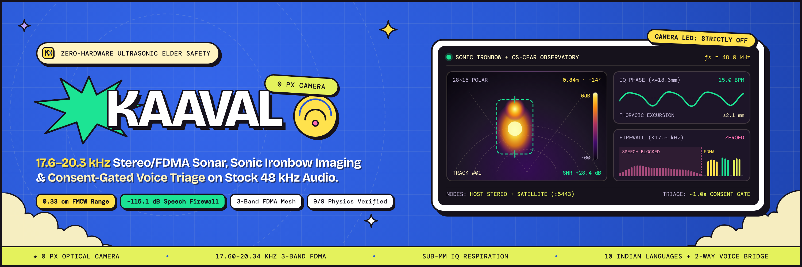
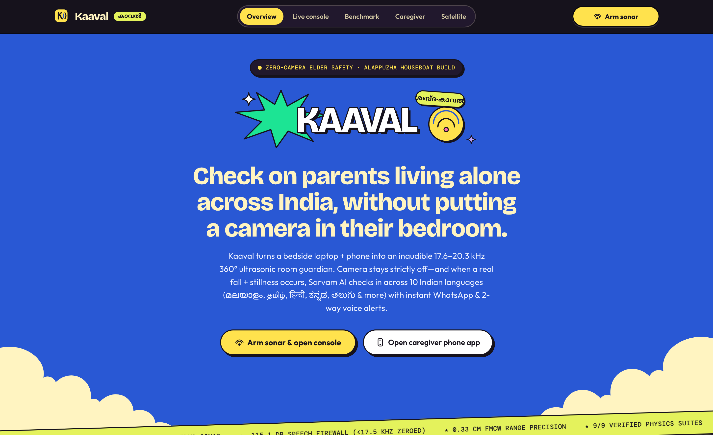
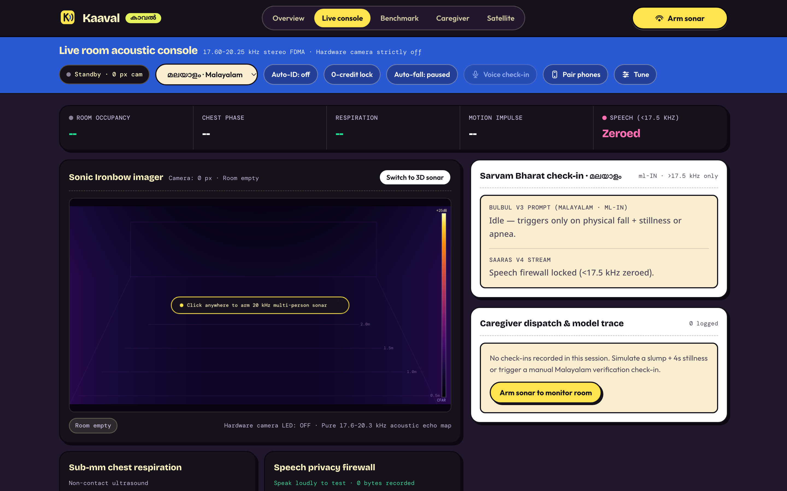
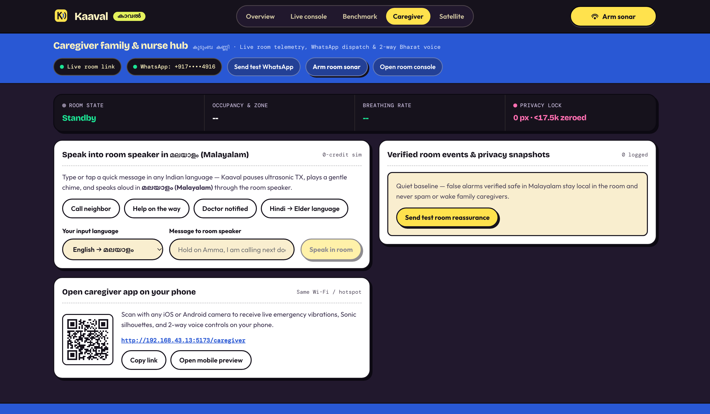
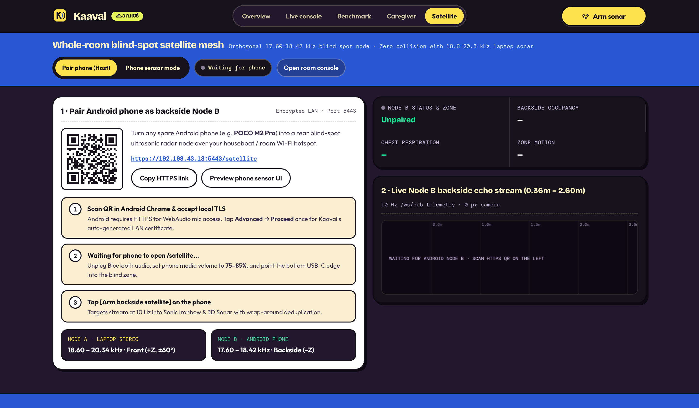
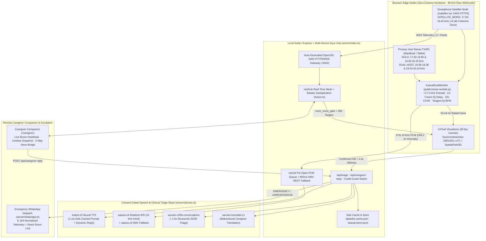
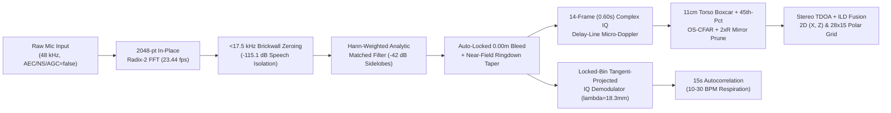
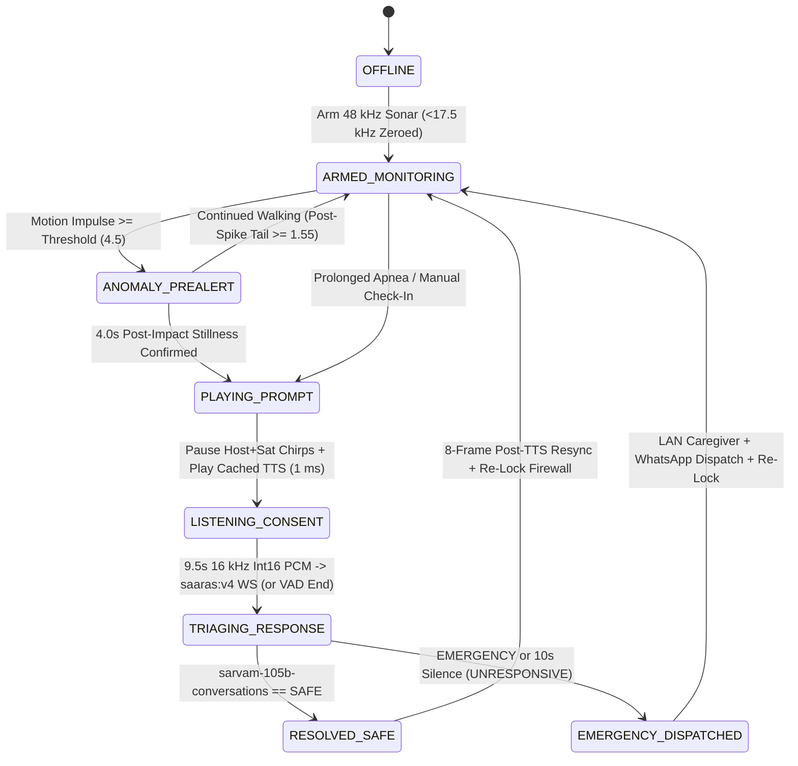

# KAAVAL — Zero-Hardware Stereo/FDMA Ultrasonic Room Radar & Consent-Gated Voice Triage



**Kaaval** turns an unmodified consumer laptop and an ordinary bedside smartphone into a **non-contact `17.60–20.34 kHz` ultrasonic room safety radar**, **camera-free Sonic Ironbow acoustic imager**, and **consent-gated clinical voice triage loop**—requiring **zero optical cameras (`0 px`, hardware webcam LED strictly off)**, **zero wearables**, **zero custom IoT sensors**, and **zero continuous speech capture**.

During routine operation (`SONAR_LOCKED`), an in-browser `48 kHz` `AudioWorklet` transmits orthogonal Tukey-tapered linear FMCW chirps while hard-zeroing every DFT frequency bin below `17.5 kHz` on the real-time audio thread (`-115.1 dB` speech isolation). Only when physical kinematics confirm a **high-impulse fall followed by `4.0 s` of post-impact stillness** (or prolonged absence of respiration) does Kaaval pause ultrasound, open a bounded **`9.5 s` `16 kHz` PCM consent window**, run **`~1.0 s` parallel clinical LLM triage + translation**, dismiss benign false alarms locally, or dispatch structured telemetry, a zero-camera Ironbow floor snapshot, and a 2-way room voice bridge to remote caregivers.

> **Deep-Dive Monograph:** For the full chronological research log, environmental acoustics analysis, and complete mathematical derivations, see **[PROJECT.md](./PROJECT.md)**.

### Live Platform Views (`0 px` Optical Camera Across Every Route)

| **01 · Product Overview (`/`)** | **02 · Sonic Ironbow & DSP Observatory (`/?view=console`)** |
| :---: | :---: |
|  |  |
| **03 · 2-Way Caregiver Companion (`/caregiver`)** | **04 · Smartphone FDMA Satellite Node (`/satellite`)** |
|  |  |

---

## 1. Research Motivation & The 3-Way Elder Monitoring Deadlock

Independent elder living faces a severe structural demographic shift alongside a persistent hardware adoption failure:

- **Demographic Acceleration (*UNFPA & IIPS India Ageing Report 2023*):** Older adults (`60+`) are the fastest-growing demographic cohort across rapidly transitioning regions (e.g., reaching **`16.5%`** today and projected at **`22.8%` by 2036** in high-longevity states vs. `10.1%` nationally), while working-age out-migration leaves millions of older parents in single-occupant or elderly-only households.
- **The Clinical "Long Lie" Pathology (*LASI Wave-1*, MoHFW / IIPS):** Over **`70%`** of older adults carry chronic conditions affecting orthostatic balance, vision, or bone density. In unwitnessed domestic falls, acute mortality, rhabdomyolysis, dehydration, and aspiration pneumonia correlate strongly not just with impact trauma, but with **"Long Lie" duration**—remaining immobilized on the floor unable to reach a phone for `4–12 hours`.

### Why Existing Monitoring Modalities Fail Residential Adoption

| Modality | Operational Failure Mode in Real Homes |
| :--- | :--- |
| **Optical RGB / IR Cameras** | Rejected in bedrooms and bathroom thresholds on human dignity grounds; residents physically cover lenses or unplug power, and cloud video streams introduce privacy exposure. |
| **Wearable Pendants & Smartwatches** | Removed during **sleep** and **bathing** (the two highest-incidence fall windows), left uncharged, or refused due to perceived frailty stigma. |
| **Standalone mmWave Radar IoT** *(e.g., 60 GHz modules)* | Requires dedicated `$120–$300` imported hardware per room **and suffers severe false-alarm fatigue** (dropped pillows, prayer/stretching postures, pets) because a silent RF sensor cannot verbally verify whether the resident is safe—causing caregivers to mute alerts. |
| **Always-Listening Smart Speakers** | Require clear vocal wake-word initiation after trauma (impossible when winded or unconscious) and continuously monitor audible household speech (`85–8,000 Hz`). |

**Core Research Thesis:** Commodity laptops, tablets, and smartphones already sit in bedrooms and living areas with `48 kHz` audio codecs (`24 kHz` Nyquist). By operating strictly in the **`17.60–20.34 kHz` near-ultrasonic passband** during routine monitoring—and unlocking audible speech (`<17.5 kHz`) **exclusively** inside a short post-anomaly verification gate—we achieve **provable camera-free/speech-free privacy** while eliminating sensor false alarms through **conversational AI verification**.

---

## 2. Prior-Art Landscape & Exact Technical Contributions

| System / Reference | Sensing Mechanism | Spatial & Range Capability | Vital Signs & Fall Kinematics | Privacy & False-Alarm Architecture | Limitation Addressed by Kaaval |
| :--- | :--- | :--- | :--- | :--- | :--- |
| **SoundWave** *(Gupta et al., MSR / UW, ACM CHI '12)* | Unmodified laptop `18–22 kHz` single-tone Continuous-Wave (CW) Doppler ($\Delta f = \frac{2v}{c}f_0$). | Radial velocity only; **zero absolute range (`0D`)**. | Near-field hand gestures; **100% blind when $v = 0$** (motionless fallen or sleeping person is indistinguishable from an empty room). | No speech capture; no triage. | Replaces CW tone with **wideband FMCW pulse compression + coherent IQ phase**, tracking motionless breathing occupants. |
| **ApneaApp** *(Nandakumar et al., UW, ACM MobiSys '15)* | Native Android mono `18–20 kHz` FMCW sonar. | `0.3–1.0 m` 1D bedside chest range; **no 2D azimuth**. | Sleep apnea event scoring; no room-scale fall impact + stillness kinematics. | Offline sleep logger; no interactive check-in. | Runs **zero-install in stock browsers**, adds **Stereo `TDOA + ILD` 2D `(X, Z)` + 3-band FDMA multi-node mesh**, `OS-CFAR` multi-person tracking, and voice triage. |
| **FingerIO / LLAP** *(UW / Nanjing, CHI / MobiCom '16)* | Phase / OFDM ultrasonic finger tracking. | `0.1–0.4 m` desk-surface tracking. | None. | None. | Scales coherent phase tracking to `0.32–3.00 m` whole-room torso localization and sub-mm ribcage respiration. |
| **Commercial Ultrasound** *(Echo 4th Gen `≥32 kHz`, Nest Hub)* | Proprietary ultrasonic transducers. | Binary room occupancy or coarse UI proximity scaling. | No respiration rate (`BPM`) or post-fall stillness verification. | Separate wake-word cloud assistant. | Operates within standard **`48 kHz` consumer speaker/mic passbands (`<20.4 kHz`)** without custom `>32 kHz` hardware. |
| **WiFi-CSI** *(Widar / ESP32-CSI)* | `2.4 / 5 GHz` OFDM Channel State Information. | Through-wall multi-meter occupancy. | Coarse RF gait/fall classification. | RF-only; no voice loop. | Requires patched NIC firmware (`Nexmon`) or dedicated ESP32 arrays—**impossible on unmodified consumer browsers**. |
| **Kaaval (Ours)** | Stock browser **3-Band Orthogonal FDMA FMCW (`17.60–20.34 kHz`, `0 px` Camera)**. | **`0.32–3.00 m` range (`0.33 cm` verified error) + `±55°` 2D stereo azimuth + `360°` satellite mesh**. | **`14`-frame IQ micro-Doppler + `OS-CFAR` (up to 3 people) + tangent IQ respiration (`0.20 BPM` err)**. | **`<17.5 kHz` DFT audio-thread firewall (`-115.1 dB`) + consent-gated `~1.0 s` LLM voice triage**. | Single-room acoustic line-of-sight (`>35 dB` wall/door isolation prevents cross-apartment sensing). |

---

## 3. System Architecture & Signal Processing Pipeline

### 3.1 End-to-End Multi-Node System Architecture



### 3.2 Real-Time `48 kHz` AudioWorklet DSP Chain (`public/sonar-worklet.js`)



### 3.3 Core Acoustic & Mathematical Formulations

1. **Range Quantization vs. Rayleigh & Carrier-Phase Resolution:**
   At $f_s = 48,000\text{ Hz}$ and speed of sound $c = 348.0\text{ m/s}$ ($29^\circ\text{C}$ humid indoor air), each time-domain correlation lag sample spans:
   $$\Delta r_{\text{bin}} = \frac{c}{2 f_s} = 3.625\text{ mm}$$
   While two-target Rayleigh separation for per-channel sweep bandwidth $B = 1.25\text{ kHz}$ is $\Delta R_{\text{Rayleigh}} = \frac{c}{2B} = 13.92\text{ cm}$, single-target matched-filter peak tracking achieves **`0.33 cm` verified accuracy**, and differential ribcage motion uses coherent carrier phase ($\Delta d = \frac{\lambda}{4\pi}\Delta\phi$ at $\lambda \approx 18.3\text{–}19.3\text{ mm}$), resolving **`< 0.5 mm`** chest excursions.

2. **3-Band Orthogonal FDMA Mesh (Unsynchronized Clock Immunity):**
   Consumer laptop tweeters roll off steeply above `20.5 kHz`, while human audibility rises below `17.0 kHz`. To run a laptop host and a smartphone satellite simultaneously in the same room **without hardware clock sync or cross-node ghost echoes**, Kaaval partitions `17.55–20.38 kHz` into three disjoint profiles:
   - **`SOLO_STEREO` (Standalone Host):** `TX-L: 17.60–18.85 kHz`, `TX-R: 19.00–20.25 kHz` (`B = 1.25 kHz`/ch, `28 cm` stereo baseline).
   - **`HOST_DUAL_STEREO` (Host Paired with Satellite):** `TX-L: 18.58–19.38 kHz`, `TX-R: 19.54–20.34 kHz` (`B = 0.80 kHz`/ch, vacating `17.56–18.46 kHz` with a `120 Hz` guard band).
   - **`SATELLITE_MONO` (Smartphone Backside/Flank Node):** `17.60–18.42 kHz` driven coherently on `L+R` (`+6 dB` output) with `directScale = 0.15` calibrated for tight `~2 cm` mobile speaker-to-mic spacing.

3. **Hann-Weighted Analytic Pulse Compression & `<17.5 kHz` Speech Firewall:**
   Each `2048`-sample chirp applies a `256`-sample (`5.3 ms`) Tukey cosine taper for click-free ultrasonic emission. On reception, `KaavalDualWorklet` zeroes all bins below `17.5 kHz` and multiplies positive sub-band bins by a raised-cosine (`Hann`) spectral window $W_{\text{Hann}}[k]$:
   $$Z_c[k] = \begin{cases} 2 \, W_{\text{Hann}}[k] \, X[k] \, S_{\text{TX},c}^*[k], & k \in [k_{\min,c}, \, k_{\max,c}] \;\; (f_k \ge 17.5\text{ kHz}) \\ 0, & \text{otherwise} \end{cases}$$
   Raising spectral weighting suppresses range sidelobes from `-18 dB` to **`-42 dB`**, preventing loud `2.3 m` rigid walls from leaking ghost peaks into near-field human range bins.

4. **Calibration-Free `14`-Frame (`0.60 s`) Complex IQ Delay-Line Canceller:**
   Standard exponential moving-average (`EMA`) clutter subtraction fails in two ways: it requires an empty room on startup, and it slowly absorbs motionless breathing humans into background clutter within `~15 s`. Kaaval instead maintains a `14`-frame (`0.60 s`) complex phasor ring buffer $z_c^{(t-14)}[m]$:
   - Rigid walls, furniture, and speaker-to-mic chassis bleed exhibit zero phase change over `0.60 s`: $\left|z_c^{(t)}[m] - z_c^{(t-14)}[m]\right| \approx 0$.
   - A seated or fallen breathing human shifts thoracic range by `1–3 mm` over `0.60 s` (`40°–120°` carrier phase rotation), illuminating human presence **from Frame 0 even if already seated at boot**, while asymmetric envelope smoothing (`0.35` attack / `0.90` hold) bridges inhale/exhale turnarounds.

5. **Order-Statistic CFAR (`OS-CFAR`), `2×R` Double-Bounce Pruning & Stereo `(X, Z)` Tracking:**
   - **OS-CFAR:** Sampling `128` range bins across `0.32–3.00 m` and taking the **45th percentile** estimates the true acoustic noise floor without self-masking when `1–3` occupants are present.
   - **Harmonic `2×R` Mirror Suppression:** At close range (`<0.9 m`), `Speaker -> Torso -> Laptop Screen -> Torso -> Mic` creates a double-bounce mirror peak at `2 × R`. Non-maximum suppression prunes weaker harmonic peaks within `±7 cm` of `2 × R_primary` when azimuth matches (`Test 9`).
   - **Stereo `TDOA + ILD` Azimuth:** Fuses inter-channel time-of-arrival lag difference with equalized stereo intensity balance across the `0.28 m` speaker baseline to produce 2D `(X, Z)` coordinates and a `28 × 15` volumetric polar grid rendered via bilinear **Sonic Ironbow** backprojection (`SonicIronbowView.tsx`).

6. **Spike-Free Tangent-Projected IQ Respiration Demodulator:**
   Instead of raw `atan2(Q, I)` (which suffers $\pm\pi$ origin-crossing spikes when static clutter shifts the IQ circle near `(0, 0)`), Kaaval tracks a slow complex arc center $\mu_{IQ}$, estimates the principal 1D oscillation tangent axis $\hat{\mathbf{u}}$ via sign-consistent power iteration, and runs normalized Pearson autocorrelation across physiological breathing lags (`2.0–6.0 s` = `10–30 BPM`).

---

## 4. Autonomous Anomaly Gate & Consent-Gated Voice State Machine



---

## 5. Key Empirical Findings & Engineering Mitigations

Every architectural mechanism in Kaaval was driven by hardware and network measurements during physical testing:

| Failure Mode Discovered | Physical / Systems Root Cause | Engineered Solution in Codebase |
| :--- | :--- | :--- |
| **OS Zeroing `18–20 kHz` Echoes** | macOS CoreAudio & mobile WebRTC `echoCancellation` / `noiseSuppression` classify speaker-correlatedchirps as acoustic feedback and cancel them. | Enforced `{ echoCancellation: false, noiseSuppression: false, autoGainControl: false }` in `sonarEngine.ts` + live track verification. |
| **Realtime STT Rejecting `48 kHz` Audio** | Streaming native `48 kHz` WebAudio frames to `saaras:v4` closes the WebSocket (`4000` invalid sample rate). | Added an in-worklet `6.8 kHz` 1-pole anti-aliasing filter + fractional `48 kHz -> 16,000 Hz` `Int16` resampler (`100 ms` zero-copy `ArrayBuffer` chunks) + pre-open server chunk queue + `850 ms` automatic `saaras:v3` RIFF WAV REST fallback. |
| **Reasoning LLM Adding `9.7 s` Voice Lag** | Standard chain-of-thought chat models spend `~8–10 s` generating hidden reasoning tokens before emitting triage JSON. | Switched to non-reasoning **`sarvam-105b-conversations`** executed concurrently via `Promise.all` alongside **`sarvam-translate:v1`**, cutting triage + translation turnaround **`9.7×` (`9,700 ms → 1,003 ms`)**. |
| **Browser Autoplay Blocking Fall Prompts** | `HTMLAudioElement.play()` throws `NotAllowedError` when a fall occurs hands-free minutes after the initial user gesture. | Decoded C5–E5 alert chimes and `bulbul:v3` MP3 buffers directly via `audioCtx.decodeAudioData()` on the already-unlocked sonar `AudioContext` (`1 ms` warm disk cache in `data/tts-cache.json`). |
| **Post-TTS Speaker Transient Self-Trigger** | Resuming `20 kHz` chirps immediately after voice playback created a 1-frame $\Delta z$ impulse against stale pre-voice echo buffers, re-triggering a false fall. | Added an `8`-frame (`resyncFrames = 8`) post-voice resynchronization gate upon returning to `SONAR_LOCKED` (`Test 3` verifies `0.00` post-TTS motion spike) + `/ws/hub` `room_voice_gate` muting paired satellites during speech. |
| **Optical Webcam LED Trust Violation** | Even an offline vision model illuminates the hardware-wired green laptop camera LED, invalidating bedroom privacy guarantees. | Removed all `video` APIs (`0` `getUserMedia({ video })` calls across the repo) and built the pure acoustic **Sonic Ironbow** bilinear polar backprojector (`SonicIronbowView.tsx`). |
| **Mobile LAN HTTP Blocking `AudioWorklet`** | Android Chrome restricts `getUserMedia` and `audioWorklet` on unencrypted `http://<LAN-IP>:5173`. | Built an auto-generating **OpenSSL SubjectAltName (`SAN`) HTTPS/WSS Gateway (`:5443`)** in `server/index.ts` + offline SVG QR pairing (`QrCodeSvg.tsx`) + Screen Wake Lock (`navigator.wakeLock`). |
| **Near-Rig Bistatic Diffraction Duplicates** | When a person sits `<1.35 m` in front of the laptop, sound diffracts around the lid to a nearby backside phone, risking double-counting. | Implemented range-wrap and SNR dominance deduplication in `src/audio/fusion.ts` (`getFilteredSatelliteTargets`). |

---

## 6. Reproducible `9/9` Physics Verification (`npm run verify`)

`npm run verify` executes **[scripts/verify-physics.mjs](./scripts/verify-physics.mjs)** inside a deterministic Node `vm` sandbox directly against `public/sonar-worklet.js` and `server/trialsStore.ts` in **`~1.67 s` with zero network calls**:

| Suite | Physical Scenario Under Test | Pass Criterion | Measured Result | Verdict |
| :--- | :--- | :--- | :--- | :--- |
| **Test 1** | Continuous-delay FMCW range recovery (`0.75 m`, `1.35 m`, `2.15 m`) + `16 kHz` Bluetooth HFP `NaN` guard | Peak error `< 1.00 cm` | `0.7504 m` (`0.04 cm`), `1.3521 m` (`0.21 cm`), `2.1533 m` (`0.33 cm`) · **Max `0.33 cm`** | **PASS** |
| **Test 2** | `<17.5 kHz` audio-thread speech firewall (`10×` / `+20 dB` `120–8,000 Hz` speech harmonics) | Leakage `< -90.0 dB` | **`-115.1 dB`** matched-filter leakage | **PASS** |
| **Test 3** | Sub-mm IQ chest respiration (`0.95 m ± 2.5 mm` @ `15.00 BPM`, `352` frames) + post-TTS resync | `|BPM err| <= 0.80`, spike `= 0` | **`14.80 BPM`** (`0.20 BPM` error), `resync_motion = 0.00` | **PASS** |
| **Test 4** | Kinematic fall + post-spike stillness separation (`EMPTY`, `SEATED`, `WALKING`, `FALL_STILLNESS`) | `4 / 4` exact classes | **`4 / 4` (`100%`)** | **PASS** |
| **Test 5** | Arm-while-seated (`0.62 m`, `16.0 BPM` from Frame 0) + `4.5×` louder rigid wooden wall (`2.35 m`) | `count = 1`, wall rejected | Wall rejected, **`0.62 m` (`0.0 cm` err)**, **`15.1 / 16.0 BPM`** | **PASS** |
| **Test 6** | Multi-person stereo cabin (`Person 1 @ 0.72 m Left`, `Person 2 @ 1.85 m Right`) | `count = 2`, L/R signs valid | `count = 2`: **`0.70 m (-34° Left)`**, **`1.83 m (+35° Right)`** | **PASS** |
| **Test 7** | Empty noisy cabin (`2×` noise floor + two rigid wooden walls at `1.40 m` & `2.55 m`) | `peopleCount = 0` | **`peopleCount = 0`** (`EMPTY_BASELINE`, zero ghosts) | **PASS** |
| **Test 8** | Dual-node 3-band FDMA isolation + smartphone mono backside (`1.18 m`, `17.0 BPM`, async clock drift) | `host_ghosts = 0`, `err < 3.5 cm` | `host_ghosts = 0`, backside **`1.18 m` (`0.2 cm` err)**, **`16.4 / 17.0 BPM`** | **PASS** |
| **Test 9** | Near-field occupant (`0.62 m`) + `35%` `2×R` torso-screen-torso mirror bounce (`1.24 m`) | Prune `2×R` ghost (`count = 1`) | **`peopleCount = 1` (`0.62 m`)** | **PASS** |

---

## 7. Repository Map (Guide for Code Review)

```text
├── public/
│   └── sonar-worklet.js          # Zero-dependency 48 kHz AudioWorklet: Radix-2 FFT, 3-band FDMA, <17.5 kHz
│                                 # firewall, 14-frame IQ micro-Doppler, OS-CFAR, 2xR prune, tangent IQ BPM
├── src/
│   ├── types.ts                  # Shared contracts for RadarFrame, FDMA profiles, triage traces & benchmarks
│   ├── languages.ts              # 10 Indian languages registry for multilingual STT/TTS check-ins & caregiver bridge
│   ├── audio/
│   │   ├── sonarEngine.ts        # WebAudio lifecycle, autoplay-safe MP3/chime decoder & /ws/stt PCM streamer
│   │   └── fusion.ts             # Near-field bistatic diffraction deduplicator (Host +Z vs Satellite -Z)
│   └── components/
│       ├── App.tsx               # 5-route controller, 4.0s post-impact stillness gate & LAN WS sync
│       ├── SonicIronbowView.tsx  # 0-pixel 360x202 bilinear scientific Ironbow acoustic backprojector
│       ├── SpatialField3D.tsx    # Interactive 3D forward-perspective volumetric acoustic observatory
│       ├── RadarScopes.tsx       # 60 fps canvas oscilloscopes (Waterfall, Range, IQ Breath, DFT Firewall)
│       ├── TriageTimeline.tsx    # Consent window monitor, incident feed & per-model latency trace table
│       ├── CaregiverView.tsx     # /caregiver mobile companion with haptic alerts & 2-way room voice bridge
│       ├── SatelliteNodeView.tsx # /satellite smartphone backside radar UI (:5443 HTTPS + Wake Lock)
│       ├── BenchmarkPanel.tsx    # Live 5.0s acoustic trial recorder & 4x4 confusion-matrix evaluator
│       ├── SaasOverview.tsx      # / architectural overview & interactive module launcher
│       ├── ArborChrome.tsx       # Persistent layout-locked navigation & operator status footer
│       └── QrCodeSvg.tsx         # Zero-dependency ISO/IEC 18004 QR generator for instant LAN phone pairing
├── server/
│   ├── index.ts                  # Express API, /ws/stt buffered proxy, /ws/hub mesh & :5443 auto-SAN HTTPS
│   ├── sarvam.ts                 # Disk-cached bulbul:v3 TTS, parallel sarvam-105b-conversations + translate
│   ├── whatsapp.ts               # E.164 emergency WhatsApp incident formatter & rate-guarded dispatcher
│   └── trialsStore.ts            # Persistent incident/trial store & physical kinematic feature classifier
├── scripts/
│   └── verify-physics.mjs        # 9-suite deterministic DSP & acoustic physics testbench (`npm run verify`)
├── probe/                        # Initial zero-dependency hardware verification oscilloscope
└── PROJECT.md                    # Extended research monograph, derivations & field testing notes
```

---

## 8. Quickstart & Multi-Device LAN Setup

### Prerequisites
- **Node.js `>= 20`** (`v22+` recommended)
- **Built-in stereo speakers + microphone** at `48 kHz` (unplug Bluetooth headsets; set speaker volume to `50–65%`)
- **Optional `.env`** (copy `.env.example` → `.env`):
  - `SARVAM_API_KEY=...` — enables live cloud STT, LLM triage, translation, and TTS synthesis (offline ultrasonic radar, Sonic Ironbow imaging, `9/9` physics verification, and `0`-credit simulation work out of the box without API keys).
  - `TEXTMEBOT_PHONE=...` & `TEXTMEBOT_API_KEY=...` — optional automatic WhatsApp caregiver dispatch on `EMERGENCY` / `UNRESPONSIVE` incidents.

### Install, Verify & Launch
```bash
npm install
npm run verify        # Run all 9 deterministic DSP & kinematic physics suites (< 2s)
npm run build         # Type-check (tsc --noEmit) + build production bundle
npm run dev:server    # Start Express + WS Hub + :5443 LAN HTTPS Gateway
npm run dev:client    # Start Vite UI on http://localhost:5173 (LAN-exposed via --host)
```

### Application Routes
| Route | Role | URL |
| :--- | :--- | :--- |
| **Overview** | Architectural summary & module launcher | `http://localhost:5173/` |
| **Live Room Console** | Sonic Ironbow imager, 3D field, 4 DSP scopes & voice triage | `http://localhost:5173/?view=console` |
| **4×4 Benchmark** | Live `5.0 s` trial recorder & confusion matrix | `http://localhost:5173/?view=benchmark` |
| **Caregiver Companion** | Remote family dashboard + 2-way room speaker bridge | `http://<HOST-LAN-IP>:5173/caregiver` |
| **Satellite Radar Node** | Smartphone backside/flank FDMA ultrasonic sensor | `https://<HOST-LAN-IP>:5443/satellite` |

---

## 9. Honest Physical Boundaries

1. **Single-Room Acoustic Containment:** `17.6–20.34 kHz` air ultrasound reflects off solid walls and closed doors (`>35 dB` attenuation). Unlike RF/WiFi-CSI, it cannot sense through masonry walls—which prevents cross-apartment neighbor surveillance in multi-unit housing, requiring one node per room (`0.32–3.00 m` effective cone).
2. **Heavy Textile Absorption:** Thin cotton sheets and mosquito netting pass near-ultrasonic chest phase cleanly, whereas thick quilted winter comforters attenuate sub-millimeter thoracic reflections.
3. **Audio Path Requirements:** Bluetooth HFP headsets (`8/16 kHz` voice codecs) strip ultrasonic frequencies; `KaavalDualWorklet` clamps bin indices safely to prevent `NaN` propagation (`Test 1`) and requires built-in device transducers for active ranging.
